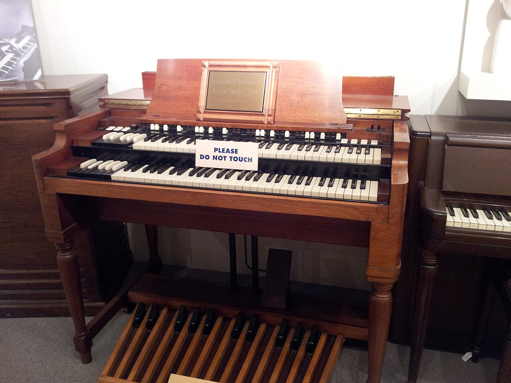

<p align="center"></p>

# B3Wiki

> **A self-updating knowledge base about the Hammond organ and the music it made possible — packaged as an [OKF v0.3](https://okf.md/) knowledge bundle.**

---

## 🆕 What's new

* **2026-11-20** — Update: OKF v0.3 conformance pass (footnote citations, `okf_version: "0.3"`)
* **2026-11-16** — Ingest: Larry Young (2 new sources)
* **2026-11-09** — Ingest: clonewheel transition (2 new sources)
* **2026-11-02** — Ingest: gospel lineage + Dr. Lonnie Smith source pass (2 new sources)

Full history: [log.md](/log.md).

---

## 🎓 What is this, format-wise?

Two ideas meet in this repo. If you've never heard of either, this section is for you.

### The llm-wiki idea

Most "AI + knowledge" systems re-derive answers from scratch on every question: chop documents into embeddings, retrieve fragments, hallucinate a stitch. Karpathy's counter-proposal — the **[LLM wiki](https://gist.github.com/karpathy/442a6bf555914893e9891c11519de94f)** — is the opposite: an LLM agent *compiles* knowledge once into a permanent, interlinked Markdown wiki, then keeps it alive.

The properties that make it work:

- **Compile, don't re-derive.** A claim is researched, written, and cross-referenced *once*. Every later query reads the compiled page instead of re-reading the raw sources.
- **Everything is traceable.** Each claim carries a provenance marker back to an immutable ingested source (`raw/`), stamped with URL + `sha256` so re-ingests detect drift.
- **Contradictions are flagged, never silently overwritten.** A contested claim stays contested until evidence resolves it.
- **An agent maintains it.** A scheduled agent ingests new sources, cross-references, lints for broken links and orphans, and commits — the wiki compounds with every run.

B3Wiki is built in exactly that house style: layered (`raw/` sources → compiled pages), wikilinked, agent-maintained.

### The OKF idea

The **[Open Knowledge Format (OKF)](https://okf.md/spec/)** is an open, vendor-free format for exchanging exactly this kind of knowledge corpus. Its entire rulebook fits on a sticky note:

- A bundle is **a directory of Markdown files with YAML frontmatter**. `git clone` it, `cat` it, diff it — no SDK, no account, no server.
- Every concept file needs exactly **one required field: `type`** (e.g. `Player`, `Instrument`, `Concept`, `Source`). Types are never centrally registered — consumers must tolerate unknown ones.
- Two **reserved filenames** at any level: `index.md` (catalog, progressive disclosure) and `log.md` (chronological update history, newest first).
- **Provenance is first-class**: `sources: [{resource, id, last_modified}]` in frontmatter, per-claim `[^id]` footnotes keyed to a source `id` (v0.3 — stable across rewrites, unlike positional numbering), and trust metadata (`generated.by`, timestamps) — so a reader can always tell *who claimed what, from where, and when*.

The bet behind OKF: almost no rules, maximum adoption. A bundle written by a human is readable by an agent; a bundle generated by one pipeline is consumable by another. The format is the contract.

### Where they meet

B3Wiki was **born an llm-wiki and is now natively an OKF bundle**. The two models turned out to map onto each other almost one-to-one — wikilinks became relative Markdown links, `^[raw/…]` markers became `[^id]` footnotes keyed to `sources[].id`, `sources` became structured `sources[]`. The conversion was automated with [`scripts/to_okf.py`](scripts/to_okf.py) and validated by [`scripts/okflint.py`](scripts/okflint.py) (spec §11): **169 files, 0 errors, 0 warnings**. The full decision record lives in [`OKF-MAPPING.md`](OKF-MAPPING.md).

So this repo is simultaneously: a Hammond encyclopedia, an llm-wiki an agent keeps alive, and a spec-conformant OKF bundle any agent or tool can consume out of the box.

## ✨ The magic of the Hammond

In 1935, a clockmaker named **Laurens Hammond** shipped an organ built from **spinning metal wheels and telephone-era electromagnets**. It was meant to be a cheap pipe organ for churches. It ended up rewriting American music.

The magic is four hacks stacked on top of each other:

- **Tonewheels** — 91 gears whirring past magnetic pickups, locked to the 50/60 Hz of the power grid. The organ literally sings *in tune with the mains*. Its imperfections — crosstalk, key click, gear murmur — are the "warmth" everyone still chases.
- **Drawbars** — nine sliders mixing harmonics live, like pipe-organ stops you can pull mid-phrase. The Hammond is the world's most successful **real-time additive synthesizer**, decades before the word existed.
- **Harmonic percussion** (B-3, 1954) — a short decaying "bong" on each key strike that lets an organ imitate a plucked string. Jimmy Smith built the vocabulary of jazz organ on it.
- **The Leslie speaker** — an invention Hammond *rejected*. Donald Leslie's rotating horn bends pitch through the Doppler effect, turning a static box into a moving wall of sound. Hammond made his connectors "Leslie-proof"; Leslie defeated them in an afternoon. The two names are now inseparable.

Church on Sunday, juke joint at midnight: a "sacred" console that grew up in gospel, then slid into jazz organ trios, soul, R&B, prog rock, ska and hip-hop samples. That duality is what this wiki maps.

## 🗂️ Bundle anatomy

86 concept pages, 60 ingested sources, all conformant OKF v0.3:

```
B3Wiki/                        # the bundle
├── index.md                   # reserved — catalog of every page (progressive disclosure)
├── log.md                     # reserved — append-only action log, newest first (§7)
├── SCHEMA.md                  # house conventions, tag taxonomy
├── OKF-MAPPING.md             # llm-wiki → OKF decision record
├── raw/                       # Layer 1 — `type: Source` concepts (Wikipedia, forums, blogs)
│   └── articles/              #   each stamped with resource URL + sha256
├── entities/                  # Layer 2 — one concept per thing
│   ├── instruments/           #   `type: Instrument` — B-3, Leslie, clonewheels…
│   ├── players/               #   `type: Player` — Jimmy Smith, Jon Lord, McGriff…
│   ├── people/                #   `type: Person` — Laurens Hammond, Don Leslie…
│   ├── manufacturers/ labels/ bands/ albums/ references/
├── concepts/                  # `type: Concept` — tonewheels, drawbars, percussion…
├── comparisons/               # `type: Comparison` — B-3 vs C-3 vs clonewheels…
└── queries/                   # `type: Query` — filed syntheses: landmark albums…
```

## 🤖 Self-updating

A scheduled agent keeps this bundle alive:

- **Enrich** — ingests 1–2 new sources per run (Wikipedia, specialized forums like organissimo, review blogs, the Hammond Hall of Fame), each stamped with `resource` URL + `sha256` so re-ingests detect drift.
- **Cross-reference** — multi-source claims carry `[^id]` footnotes back to `raw/`; every page is linked into the graph, no orphans.
- **Lint & push** — [`scripts/okflint.py`](scripts/okflint.py) checks spec §11 conformance (frontmatter shape, reserved-file rules, trust timestamps, footnote↔source joins), then commits straight to `main`.

## 📖 How to use it

- **Browse** — start at [`index.md`](index.md).
- **Open in Obsidian** — the bundle is an Obsidian vault out of the box: YAML frontmatter, graph view and Markdown links all work.
- **Feed it to an agent** — it's a conformant OKF bundle: any agent can `git clone` it, read `index.md`, route by `type`, and answer with citations — no SDK, no integration code.
- **Ask it** — the wiki answers from compiled pages with citations ("based on [Hammond B-3](/entities/instruments/hammond-b3.md) and [Leslie Speaker](/entities/instruments/leslie-speaker.md)…"), so answers improve with every ingested source.

## 🔗 Start here

| If you want… | Read |
|---|---|
| The icon and why it dominates jazz | [`entities/instruments/hammond-b3.md`](entities/instruments/hammond-b3.md) |
| How the sound is actually made | [`concepts/tonewheel-generator.md`](concepts/tonewheel-generator.md) · [`concepts/drawbars.md`](concepts/drawbars.md) |
| The feud that made the sound | [`entities/people/donald-leslie.md`](entities/people/donald-leslie.md) |
| What to listen to | [`queries/hammond-landmark-albums.md`](queries/hammond-landmark-albums.md) |
| Vintage vs digital | [`comparisons/b3-vs-clonewheels.md`](comparisons/b3-vs-clonewheels.md) |
| How the OKF conversion was done | [`OKF-MAPPING.md`](OKF-MAPPING.md) |

---

## 📷 Credits

Banner: **"Hammond B3, Museum of Making Music"** by [doryfour](https://www.flickr.com/people/28732946@N08), via [Wikimedia Commons](https://commons.wikimedia.org/wiki/File:Hammond_B3,_Museum_of_Making_Music.jpg), licensed [CC BY-SA 2.0](https://creativecommons.org/licenses/by-sa/2.0).

All ingested sources are credited per-file in `raw/` frontmatter (`resource`) and cited inline with numbered citations resolving to each page's `# Citations` section.

---

*Content licensed [CC BY-SA 4.0](LICENSE) · © 2026 Cedric Lejeune · 86 pages and counting · an OKF v0.3 bundle built by an agent, curated by a human, powered by spinning metal.* 🎹
