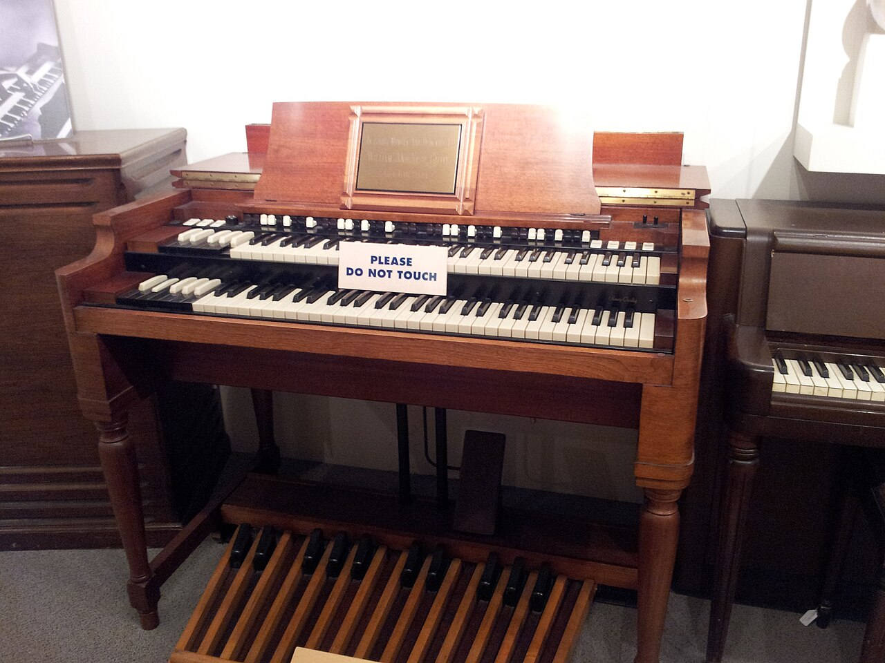

<p align="center"></p>

# B3Wiki

> **A self-updating, llm-wiki-shaped knowledge base about the Hammond organ and the music it made possible.**

---

## ✨ The magic of the Hammond

In 1935, a clockmaker named **Laurens Hammond** shipped an organ built from **spinning metal wheels and telephone-era electromagnets**. It was meant to be a cheap pipe organ for churches. It ended up rewriting American music.

The magic is four hacks stacked on top of each other:

- **Tonewheels** — 91 gears whirring past magnetic pickups, locked to the 50/60 Hz of the power grid. The organ literally sings *in tune with the mains*. Its imperfections — crosstalk, key click, gear murmur — are the "warmth" everyone still chases.
- **Drawbars** — nine sliders mixing harmonics live, like pipe-organ stops you can pull mid-phrase. The Hammond is the world's most successful **real-time additive synthesizer**, decades before the word existed.
- **Harmonic percussion** (B-3, 1954) — a short decaying "bong" on each key strike that lets an organ imitate a plucked string. Jimmy Smith built the vocabulary of jazz organ on it.
- **The Leslie speaker** — an invention Hammond *rejected*. Donald Leslie's rotating horn bends pitch through the Doppler effect, turning a static box into a moving wall of sound. Hammond made his connectors "Leslie-proof"; Leslie defeated them in an afternoon. The two names are now inseparable.

Church on Sunday, juke joint at midnight: a "sacred" console that grew up in gospel, then slid into jazz organ trios, soul, R&B, prog rock, ska and hip-hop samples. That duality is what this wiki maps.

## 🗂️ What this repo is

A **[Karpathy-style LLM wiki](https://gist.github.com/karpathy/442a6bf555914893e9891c11519de94f)**: knowledge compiled once into interlinked Markdown, not re-derived from scratch on every question. Every claim is traceable to an ingested source; contradictions are flagged, never silently overwritten.

```
B3Wiki/
├── SCHEMA.md            # conventions, frontmatter, tag taxonomy
├── index.md             # catalog of every page
├── log.md               # append-only action log
├── raw/                 # Layer 1 — immutable sources (Wikipedia, forums, blogs), sha256-stamped
│   ├── articles/
│   └── forums/
├── entities/            # Layer 2 — one page per thing
│   ├── instruments/     #   B-3, Leslie, clonewheels (Korg CX-3, Roland VK, Nord…)
│   ├── players/         #   Jimmy Smith, Jon Lord, Medeski, McGriff, Auger…
│   ├── manufacturers/   #   Hammond, Suzuki, Korg, Roland…
│   ├── labels/          #   Hammondbeat…
│   └── people/          #   Laurens Hammond, Don Leslie, Renato Lombardi…
├── concepts/            # tonewheels, drawbars, percussion, vibrato, portables…
├── comparisons/         # B-3 vs C-3 vs A-100 vs Farfisa vs clonewheels
└── queries/             # filed syntheses: landmark albums, players beyond Jimmy Smith
```

## 🤖 Self-updating

A scheduled agent keeps this wiki alive:

- **Enrich** — ingests 1–2 new sources per run (Wikipedia, specialized forums like organissimo, review blogs, the Hammond Hall of Fame), each stamped with `source_url` + `sha256` so re-ingests detect drift.
- **Cross-reference** — multi-source claims carry provenance markers (`^[raw/...]`); every page is wikilinked into the graph, no orphans.
- **Lint & push** — broken links, orphan pages and tag drift get fixed, then committed straight to `main`.

## 📖 How to use it

- **Browse** — start at [`index.md`](index.md).
- **Open in Obsidian** — the repo is an Obsidian vault out of the box: `[[wikilinks]]`, graph view and YAML frontmatter all work.
- **Ask it** — the wiki answers from compiled pages with citations ("based on [[hammond-b3]] and [[leslie-speaker]]…"), so answers improve with every ingested source.

## 🔗 Start here

| If you want… | Read |
|---|---|
| The icon and why it dominates jazz | [`entities/instruments/hammond-b3.md`](entities/instruments/hammond-b3.md) |
| How the sound is actually made | [`concepts/tonewheel-generator.md`](concepts/tonewheel-generator.md) · [`concepts/drawbars.md`](concepts/drawbars.md) |
| The feud that made the sound | [`entities/people/donald-leslie.md`](entities/people/donald-leslie.md) |
| What to listen to | [`queries/hammond-landmark-albums.md`](queries/hammond-landmark-albums.md) |
| Vintage vs digital | [`comparisons/b3-vs-clonewheels.md`](comparisons/b3-vs-clonewheels.md) |

---

## 📷 Credits

Banner: **"Hammond B3, Museum of Making Music"** by [doryfour](https://www.flickr.com/people/28732946@N08), via [Wikimedia Commons](https://commons.wikimedia.org/wiki/File:Hammond_B3,_Museum_of_Making_Music.jpg), licensed [CC BY-SA 2.0](https://creativecommons.org/licenses/by-sa/2.0).

All ingested sources are credited per-file in `raw/` frontmatter (`source_url`) and cited inline with provenance markers.

---

*MIT licensed · 37 pages and counting · built by an agent, curated by a human, powered by spinning metal.* 🎹
